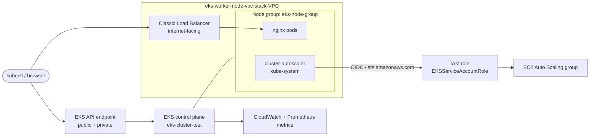
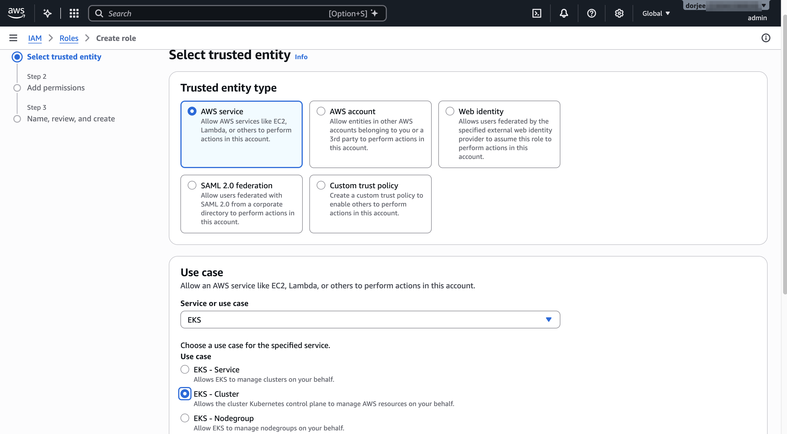
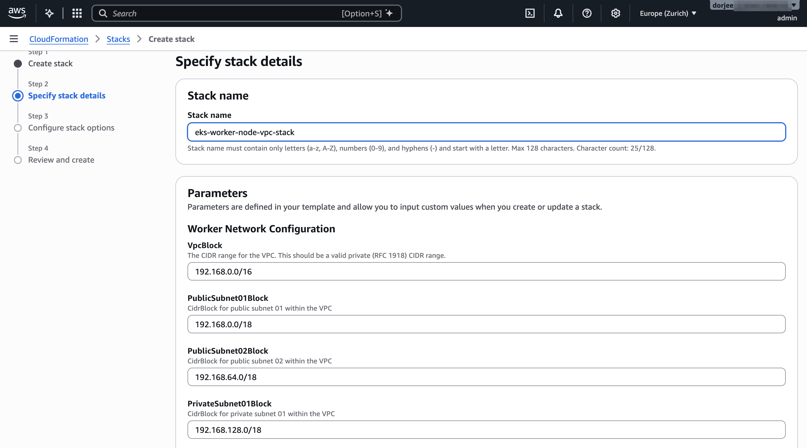

# eks-cluster-node-group


-FF4F8B?logo=amazonaws&logoColor=white)
-informational)


Teams running variable workloads on Kubernetes need capacity that grows and shrinks with demand — manually sized clusters either waste money sitting idle or fall over under load. Built as a practice project to learn how a production-style EKS setup fits together end to end, this repository stands up a minimal but complete platform: a dedicated VPC, a managed node group, and a Cluster Autoscaler that adds nodes when pods can't schedule and removes them once load drops, with AWS access through OIDC rather than static credentials.

Every component — network, IAM, cluster, autoscaler — was configured explicitly through the console and kubectl, without IaC, so each decision and its tradeoff had to be understood rather than inherited from a module.

Sole engineer: designed, built and documented the whole stack; documentation drafted with AI assistance and every claim verified against the actual build.

**What you get:** an EKS control plane in a dedicated VPC with 4 subnets (public and private), a managed node group of 2 `t3.small` On-Demand nodes, a Cluster Autoscaler wired to AWS through OIDC, and a sample nginx deployment exposed through a `LoadBalancer` service.

**Verified state:** 2 of 2 nodes `Ready`, the nginx pod `1/1 Running`, the Classic Load Balancer reports 2 of 2 instances in service, the autoscaler pod was still `Running` with 0 restarts after 6h15m, and a full scale-up/down cycle was verified (see [Infrastructure](#infrastructure)).

---

## Architecture




---

## Tech stack

| Component | Tool | Why |
|---|---|---|
| Kubernetes control plane | Amazon EKS | Managed control plane, no etcd or API server to operate |
| Networking | AWS VPC via CloudFormation template | Default VPC is not suited for EKS; the AWS template gives public and private subnets out of the box |
| Worker nodes | EKS managed node group (Amazon Linux 2023, `t3.small`, On-Demand) | One node group object instead of creating each EC2 instance by hand |
| Autoscaling | Kubernetes Cluster Autoscaler | Scales the node group up and down through the AWS Auto Scaling API |
| Auth to AWS | IAM OIDC identity provider + web identity role | Gives the autoscaler temporary credentials without static keys |
| Ingress to the app | Kubernetes `Service` of type `LoadBalancer` | Provisions an internet-facing Classic Load Balancer |
| Observability | CloudWatch, Prometheus metrics | Enabled by checkbox at cluster creation; not actively used |
| CLI | `aws`, `kubectl` | Cluster access and deployment |

---

## Quick start

Everything below was done in the AWS Management Console unless a command is shown.


### Prerequisites

- AWS account with permission to create IAM roles, VPC stacks and EKS clusters
- `aws` CLI configured (`aws configure list` shows the active region)
- `kubectl`

### Repository contents

```bash
git clone https://gitlab.com/cloudbuildops/eks-cluster-node-group.git
```

| File | Purpose |
|---|---|
| `cluster-autoscaler-autodiscovery.yaml` | ServiceAccount, RBAC (ClusterRole, Role and bindings) and Deployment for the Cluster Autoscaler |
| `custom-policy.json` | IAM policy attached to the autoscaler role |
| `nginx-config.yaml` | Sample nginx Deployment and `LoadBalancer` Service |

### 1. Create the EKS cluster IAM role

IAM is global, not regional.

1. IAM > Access Management > Roles > **Create role**
2. Trusted entity type: **AWS service**
3. Use case: **EKS**, then **EKS - Cluster** (not "EKS - Service")
4. Role name used here: `eks-cluster-role`



For this role type the console requires the AWS managed policy `AmazonEKSClusterPolicy`, and it is the only policy attached.


### 2. Create the VPC for the worker nodes

Use the AWS CloudFormation template for public and private subnets from the [EKS user guide](https://docs.aws.amazon.com/eks/latest/userguide/creating-a-vpc.html).

1. CloudFormation > **Create stack** > choose an existing template
2. Template source: Amazon S3 URL, using `https://s3.us-west-2.amazonaws.com/amazon-eks/cloudformation/2020-10-29/amazon-eks-vpc-private-subnets.yaml`
3. Stack name used here: `eks-worker-node-vpc-stack`
4. After creation, open the **Outputs** tab and note `SecurityGroups`, `SubnetIds` and `VpcId`. You need them for the cluster.


The parameters are a `192.168.0.0/16` VPC with two public and two private `/18` subnets (full table under [Infrastructure](#infrastructure)).



The stack ends in `CREATE_COMPLETE`, and its Outputs tab lists the 3 values the cluster needs.


