# eks-cluster-node-group


-FF4F8B?logo=amazonaws&logoColor=white)
-informational)


Teams running variable workloads on Kubernetes need capacity that grows and shrinks with demand — manually sized clusters either waste money sitting idle or fall over under load. Built as a practice project to learn how a production-style EKS setup fits together end to end, this repository stands up a minimal but complete platform: a dedicated VPC, a managed node group, and a Cluster Autoscaler that adds nodes when pods can't schedule and removes them once load drops, with AWS access through OIDC rather than static credentials.

Every component — network, IAM, cluster, autoscaler — was configured explicitly through the console and kubectl, without IaC, so each decision and its tradeoff had to be understood rather than inherited from a module.

Sole engineer: designed, built and documented the whole stack; documentation drafted with AI assistance and every claim verified against the actual build.

**What you get:** an EKS control plane in a dedicated VPC with 4 subnets (public and private), a managed node group of 2 `t3.small` On-Demand nodes, a Cluster Autoscaler wired to AWS through OIDC, and a sample nginx deployment exposed through a `LoadBalancer` service.

**Verified state:** 2 of 2 nodes `Ready`, the nginx pod `1/1 Running`, the Classic Load Balancer reports 2 of 2 instances in service, the autoscaler pod was still `Running` with 0 restarts after 6h15m, and a full scale-up/down cycle was verified (see [Infrastructure](#infrastructure)).

---

## Architecture

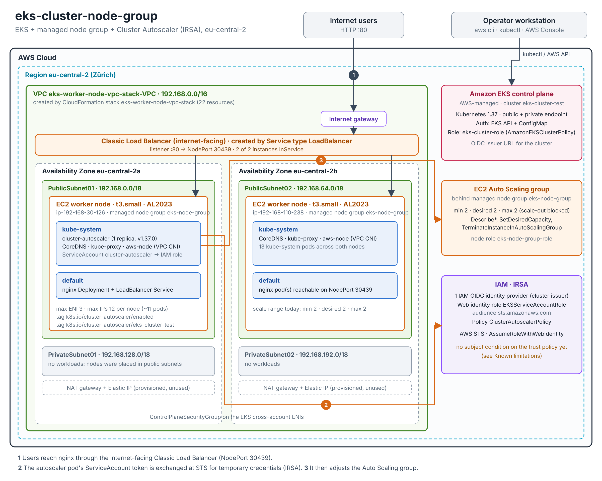

Editable source: [`screenshots/00-architecture.svg`](screenshots/00-architecture.svg)

---

## Tech stack

| Component | Tool | Why |
|---|---|---|
| Kubernetes control plane | Amazon EKS | Managed control plane, no etcd or API server to operate |
| Networking | AWS VPC via CloudFormation template | Default VPC is not suited for EKS; the AWS template gives public and private subnets out of the box |
| Worker nodes | EKS managed node group (Amazon Linux 2023, `t3.small`, On-Demand) | One node group object instead of creating each EC2 instance by hand |
| Autoscaling | Kubernetes Cluster Autoscaler | Scales the node group up and down through the AWS Auto Scaling API |
| Auth to AWS | IAM OIDC identity provider + web identity role | Gives the autoscaler temporary credentials without static keys |
| Ingress to the app | Kubernetes `Service` of type `LoadBalancer` | Provisions an internet-facing Classic Load Balancer |
| Observability | CloudWatch, Prometheus metrics | Enabled by checkbox at cluster creation; not actively used |
| CLI | `aws`, `kubectl` | Cluster access and deployment |

---

## Build walkthrough

Everything below was done in the AWS Management Console unless a command is shown.


### Prerequisites

- AWS account with permission to create IAM roles, VPC stacks and EKS clusters
- `aws` CLI configured (`aws configure list` shows the active region)
- `kubectl`

### Repository contents

```bash
git clone https://gitlab.com/cloudbuildops/eks-cluster-node-group.git
```

| File | Purpose |
|---|---|
| `cluster-autoscaler-autodiscovery.yaml` | ServiceAccount, RBAC (ClusterRole, Role and bindings) and Deployment for the Cluster Autoscaler |
| `custom-policy.json` | IAM policy attached to the autoscaler role |
| `nginx-config.yaml` | Sample nginx Deployment and `LoadBalancer` Service |

### 1. Create the EKS cluster IAM role

IAM is global, not regional.

1. IAM > Access Management > Roles > **Create role**
2. Trusted entity type: **AWS service**
3. Use case: **EKS**, then **EKS - Cluster** (not "EKS - Service")
4. Role name used here: `eks-cluster-role`


For this role type the console requires the AWS managed policy `AmazonEKSClusterPolicy`, and it is the only policy attached.

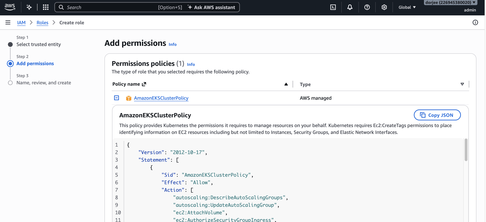

### 2. Create the VPC for the worker nodes

Use the AWS CloudFormation template for public and private subnets from the [EKS user guide](https://docs.aws.amazon.com/eks/latest/userguide/creating-a-vpc.html).

1. CloudFormation > **Create stack** > choose an existing template
2. Template source: Amazon S3 URL, using `https://s3.us-west-2.amazonaws.com/amazon-eks/cloudformation/2020-10-29/amazon-eks-vpc-private-subnets.yaml`
3. Stack name used here: `eks-worker-node-vpc-stack`
4. After creation, open the **Outputs** tab and note `SecurityGroups`, `SubnetIds` and `VpcId`. You need them for the cluster.

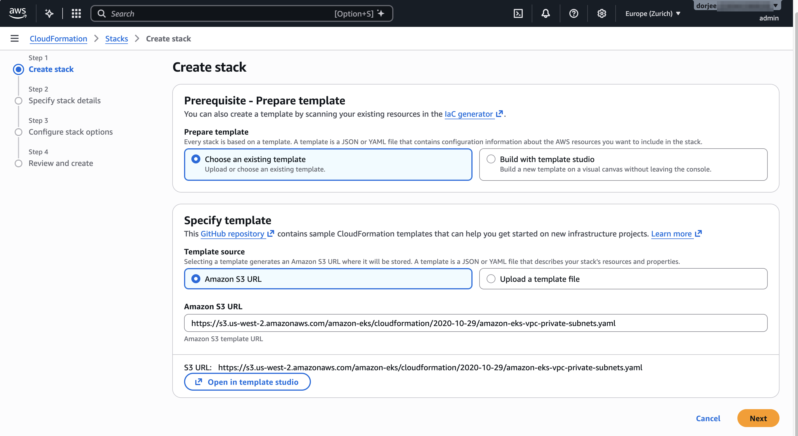

The parameters are a `192.168.0.0/16` VPC with two public and two private `/18` subnets (full table under [Infrastructure](#infrastructure)).


The stack ends in `CREATE_COMPLETE`, and its Outputs tab lists the 3 values the cluster needs.

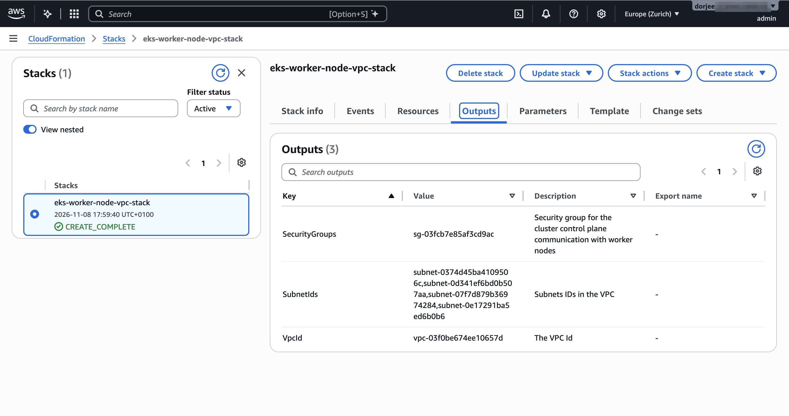

### 3. Create the EKS cluster (control plane)

| Step | Setting |
|---|---|
| Configure cluster | Custom configuration, EKS Auto Mode **off** |
| Name | `eks-cluster-test` |
| Cluster IAM role | `eks-cluster-role` |
| Cluster access | Allow cluster administrator access |
| Authentication mode | EKS API and ConfigMap |
| Networking | VPC `eks-worker-node-vpc-stack-VPC`, the 4 subnets from the stack, additional security group `ControlPlaneSecurityGroup` from the stack |
| Endpoint access | Public and private |
| Observability | Prometheus metrics and CloudWatch |
| Add-ons | Defaults (CoreDNS, kube-proxy, Amazon VPC CNI), latest versions. The overview shows 7 under Add-ons; the pods show metrics-server, eks-pod-identity-agent and eks-node-monitoring-agent next to the three defaults. |

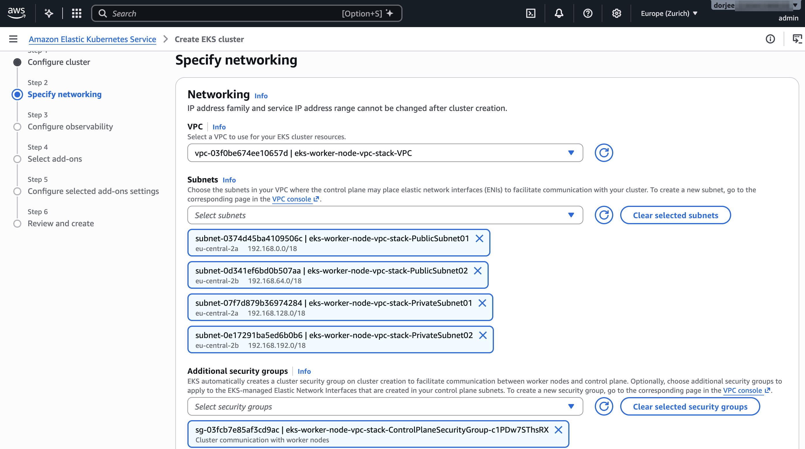

Once created, the cluster is Active on Kubernetes 1.37 (standard support until December 1, 2027, per the console). The overview also shows the OpenID Connect provider URL that step 7 needs.

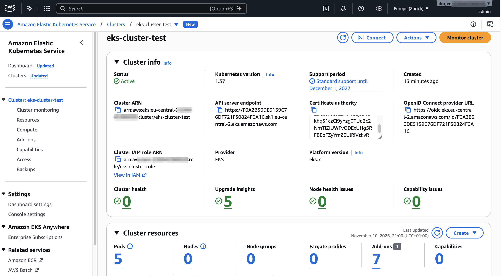


### 4. Connect kubectl

Check the region the cluster was created in:

```bash
aws configure list
```

Shows the region your CLI uses. It should be `eu-central-2` (Zürich), because `update-kubeconfig` looks for the cluster there.

```bash
aws eks update-kubeconfig --name eks-cluster-test
```

Writes the cluster endpoint and auth settings into your kubeconfig so `kubectl` can talk to the cluster.

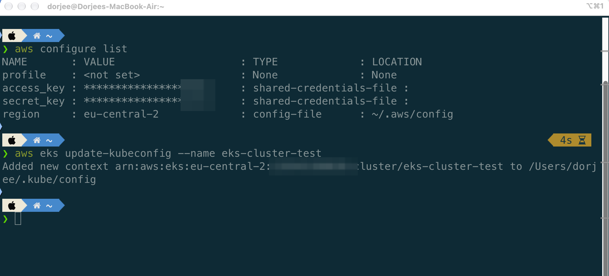


```bash
kubectl cluster-info
```

`cluster-info` should show the same API endpoint as the cluster overview page.

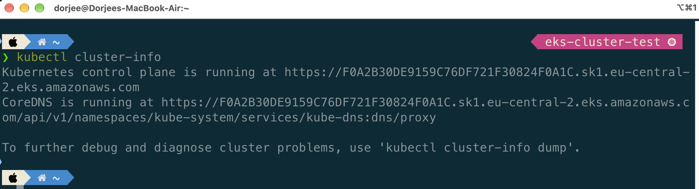

### 5. Create the node group IAM role

IAM > Roles > Create role > AWS service > use case **EC2**.

Attach these policies so the kubelet on the workers can do its job:

- `AmazonEKSWorkerNodePolicy`
- `AmazonEC2ContainerRegistryReadOnly` (pull images)
- `AmazonEKS_CNI_Policy` (container networking)

Role name used here: `eks-node-group-role`

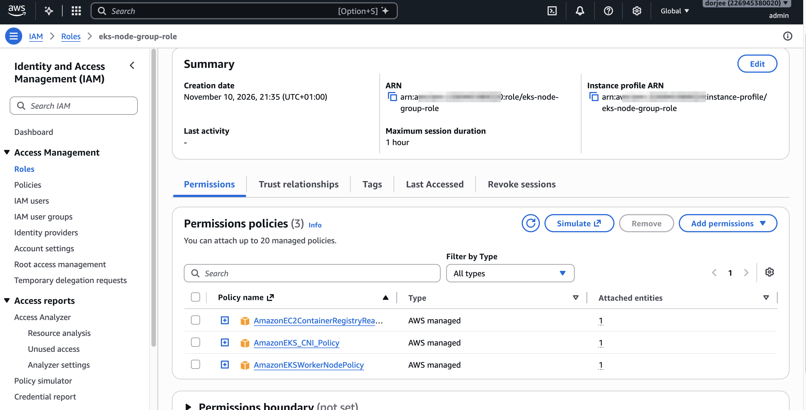

### 6. Add the node group

EKS > cluster > Compute > **Add node group**

| Setting | Value |
|---|---|
| Name | `eks-node-group` |
| Node IAM role | `eks-node-group-role` |
| AMI type | Amazon Linux 2023 |
| Capacity type | On-Demand |
| Instance type | `t3.small` |
| Disk size | 20 GiB |
| Desired / min / max size | 2 / 2 / 2 |
| Max unavailable during update | 1 node |
| Remote access | Enabled, EC2 key pair, allowed from selected security groups |

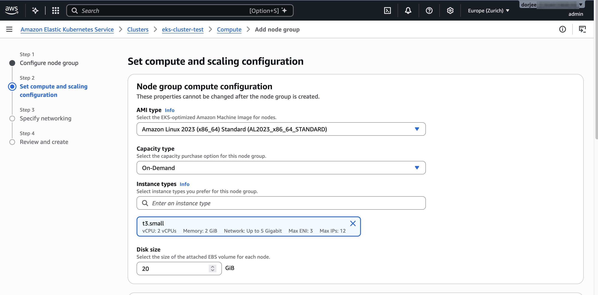

The node group is Active with 2 `t3.small` On-Demand nodes (AMI release `1.37.1-20261107`), both managed by `eks-node-group`.

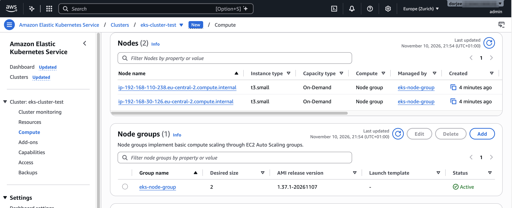

```bash
kubectl get nodes
```

Lists the worker nodes. Both were `Ready` on v1.37.1 (5m26s and 5m25s old in this run).

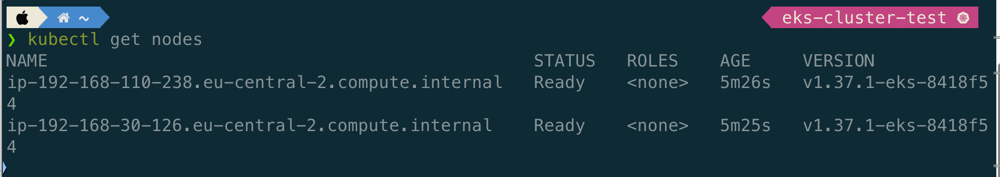

### 7. Configure the Cluster Autoscaler

See [Infrastructure](#infrastructure) for the IAM and OIDC setup, then:

```bash
kubectl apply -f cluster-autoscaler-autodiscovery.yaml
```

Creates the service account, RBAC rules and the autoscaler Deployment in `kube-system`.

```bash
kubectl get deployment -n kube-system cluster-autoscaler
```

Confirms the Deployment is up and its replica is ready.

```bash
kubectl get pod -n kube-system
```

Lists the system pods and gives you the exact name of the autoscaler pod.


```bash
kubectl get pod cluster-autoscaler-58c9644586-lvmsz -n kube-system -o wide
```

Shows which node the autoscaler pod landed on, plus its IP. The pod name suffix differs on every deployment. In this run it was `Running` on `ip-192-168-30-126` with pod IP `192.168.27.27`. All 13 kube-system pods were `Running` with 0 restarts, and the autoscaler pod was 6h15m old.

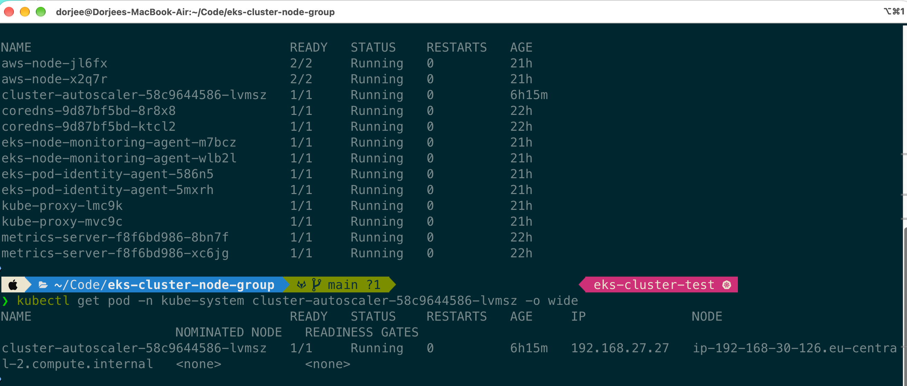

```bash
kubectl logs -n kube-system cluster-autoscaler-58c9644586-lvmsz > las-logs.txt
```

Saves the autoscaler logs to a file, which is where you check node group discovery and scaling decisions (verbosity is `--v=4`).

### 8. Deploy the sample application

Save the manifest below as `nginx-config.yaml`:

```yaml
apiVersion: apps/v1
kind: Deployment
metadata:
  name: nginx
spec:
  selector:
    matchLabels:
      app: nginx
  replicas: 1
  template:
    metadata:
      labels:
        app: nginx
    spec:
      containers:
      - name: nginx
        image: nginx
        ports:
        - containerPort: 80
---
apiVersion: v1
kind: Service
metadata:
  name: nginx
  labels:
    app: nginx
spec:
  ports:
  - name: http
    port: 80
    protocol: TCP
    targetPort: 80
  selector:
    app: nginx
  type: LoadBalancer
```

```bash
kubectl apply -f nginx-config.yaml
```

Creates the nginx Deployment and a `LoadBalancer` Service, which makes AWS provision a load balancer in front of it.

```bash
kubectl get pod
```

Shows the nginx pod, which was `1/1 Running` after 6 seconds.

```bash
kubectl get svc
```

Shows the `nginx` service as type `LoadBalancer`, with an external hostname under `eu-central-2.elb.amazonaws.com` and port `80:30439/TCP`.

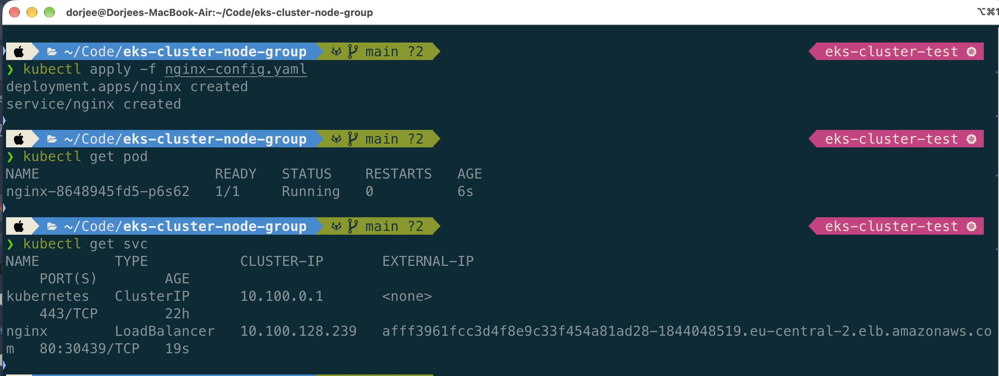

The Service came up as an internet-facing Classic Load Balancer across `eu-central-2a` and `eu-central-2b`, with 2 of 2 instances in service. The nginx welcome page answers on its DNS name over plain HTTP.

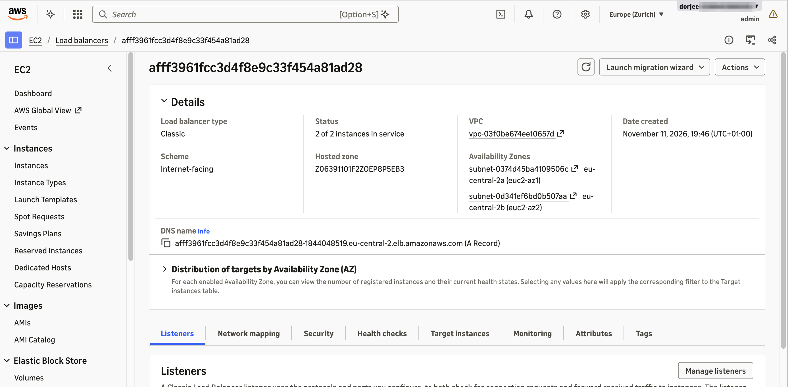

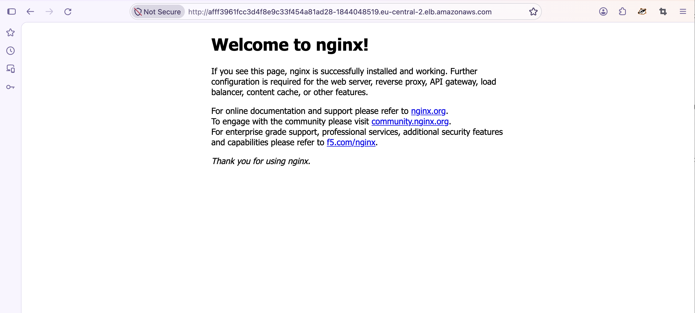

---

## Infrastructure

**Region.** `eu-central-2` (Zürich).

**Network.** One VPC created from the AWS CloudFormation template, with public and private subnets (4 subnets total). The load balancer is internet-facing. The worker nodes run in the public subnets: their private IPs (`192.168.30.126` and `192.168.110.238`) fall inside the two public CIDR blocks, and they have public IPv4 addresses (see the EC2 screenshot below).

| Subnet | AZ | CIDR |
|---|---|---|
| PublicSubnet01 | eu-central-2a | 192.168.0.0/18 |
| PublicSubnet02 | eu-central-2b | 192.168.64.0/18 |
| PrivateSubnet01 | eu-central-2a | 192.168.128.0/18 |
| PrivateSubnet02 | eu-central-2b | 192.168.192.0/18 |

The VPC block is `192.168.0.0/16`. The stack creates 22 resources, including an internet gateway and 2 NAT gateways with their Elastic IPs. Since the nodes sit in public subnets they do not need the NAT gateways, which are billed while they exist.

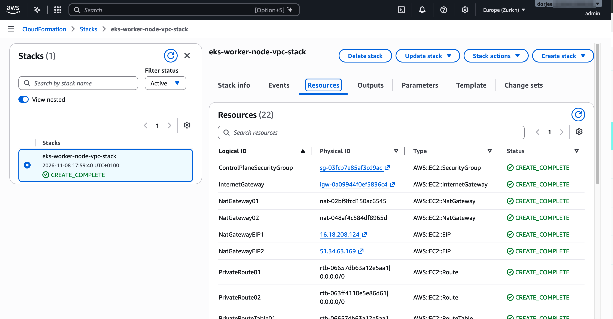

**Control plane.** `eks-cluster-test`, endpoint reachable from outside the VPC (for `kubectl`) and from inside it.

**Compute.** Managed node group `eks-node-group`: 2 x `t3.small`, On-Demand, Amazon Linux 2023, spread over `eu-central-2a` and `eu-central-2b`. The console shows Kubernetes 1.37 for the control plane, and the nodes run v1.37.1. Rolling updates replace 1 node at a time. The console lists Max ENI 3 and Max IPs 12 for `t3.small`, which limits pod density per node. The 2 nodes run 13 kube-system pods, including the autoscaler.

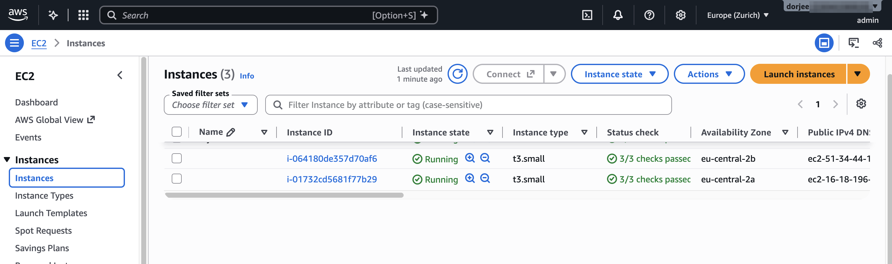

The EC2 list also shows a third instance. It was created earlier and is not part of this project; the two nodes of `eks-node-group` are the ones in eu-central-2a and 2b.

**Autoscaling.** The Cluster Autoscaler needs to call the AWS API, so trust is set up between AWS and the cluster with OIDC:

1. Create an IAM policy (`ClusterAutoscalerPolicy`):

```json
{
    "Version": "2012-10-17",
    "Statement": [
        {
            "Action": [
                "autoscaling:DescribeAutoScalingGroups",
                "autoscaling:DescribeAutoScalingInstances",
                "autoscaling:DescribeLaunchConfigurations",
                "autoscaling:DescribeScalingActivities",
                "autoscaling:SetDesiredCapacity",
                "autoscaling:TerminateInstanceInAutoScalingGroup",
                "ec2:DescribeInstanceTypes",
                "ec2:DescribeLaunchTemplateVersions"
            ],
            "Resource": "*",
            "Effect": "Allow"
        }
    ]
}
```

2. IAM > Identity providers > **Add provider**
   - Type: OpenID Connect
   - Provider URL: the OIDC issuer URL from the cluster overview
   - Audience: `sts.amazonaws.com`
3. Create a role with trusted entity **Web identity**, pick that provider, audience `sts.amazonaws.com`, attach `ClusterAutoscalerPolicy`. Role name used here: `EKSServiceAccountRole`.

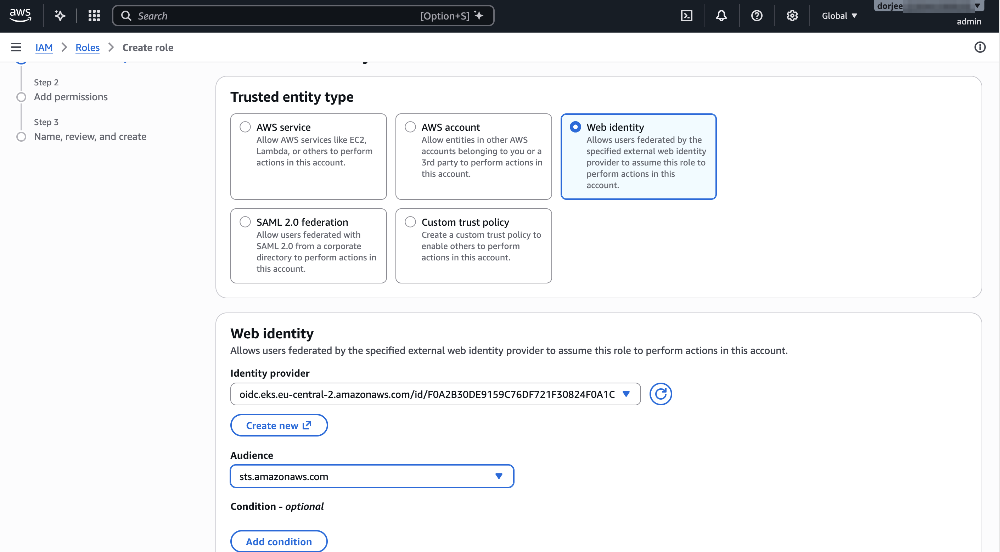

One caveat discovered after the build: the console wizard sets only the audience condition. To restrict assumption to the autoscaler's service account, the trust policy needs a subject condition:

```json
"Condition": {
    "StringEquals": {
        "<OIDC-PROVIDER-HOST>:aud": "sts.amazonaws.com",
        "<OIDC-PROVIDER-HOST>:sub": "system:serviceaccount:kube-system:cluster-autoscaler"
    }
}
```

Without it, any service account holding a valid OIDC token could assume the role. See [Known limitations](#known-limitations-and-production-gaps).

In the autoscaler manifest, change the following.

ServiceAccount annotation:

```yaml
eks.amazonaws.com/role-arn: arn:aws:iam::<ACCOUNT_ID>:role/EKSServiceAccountRole
```

Pod annotation on the Deployment:

```yaml
cluster-autoscaler.kubernetes.io/safe-to-evict: "false"
```

Container args:

```yaml
- --node-group-auto-discovery=asg:tag=k8s.io/cluster-autoscaler/enabled,k8s.io/cluster-autoscaler/eks-cluster-test
- --balance-similar-node-groups
- --skip-nodes-with-system-pods=false
```

Image and region:

```yaml
containers:
  - image: registry.k8s.io/autoscaling/cluster-autoscaler:v1.37.0
    name: cluster-autoscaler
    env:
      - name: AWS_REGION
        value: "eu-central-2"
```

Match the autoscaler version to your cluster's Kubernetes version (check the [autoscaler tags](https://github.com/kubernetes/autoscaler/tags)). The control plane is 1.37, the nodes run v1.37.1 and the autoscaler image is v1.37.0, so the minor versions match.

The manifest in the repo also sets:

- RBAC for the autoscaler: a `ClusterRole` and `Role` with matching bindings, scoped to the `kube-system` service account
- `priorityClassName: system-cluster-critical`
- CPU and memory requests and limits (100m CPU, 600Mi memory)
- `--expander=least-waste` and `--skip-nodes-with-local-storage=false`
- `--v=4` logging

**Scale-up/down test.** To verify the autoscaler end to end, the node group limits were temporarily raised from 2/2 to 2/4, and the nginx Deployment was scaled to 20 replicas. That's more than the 2 baseline nodes could fit, so the extra pods sat `Pending` until the autoscaler added nodes, first scaling up to 3, then to the maximum of 4. Once the new nodes joined `Ready`, all replicas scheduled. Scaling the Deployment back down caused the autoscaler to remove the extra nodes after the usual ~10-minute delay, returning the group to 2 nodes. The limits were then reset to 2/2.

The cluster has since been deleted, so there are no command outputs or screenshots from this test. The replica count and node sizes above are worked out from the pod-capacity math, not captured from the run.

**Why 20?** With no CPU/memory requests on the nginx pods, only the per-node pod limit triggers scale-ups. A `t3.small` fits about 11 pods (3 × (4 − 1) + 2 = 11, from Max ENI 3 and Max IPs 12), the 2 baseline nodes run 13 system pods, and each extra node adds 2 more — leaving 9 free slots at 2 nodes, 18 at 3, 27 at 4. Twenty replicas therefore doesn't fit on 3 nodes and forces the group to its maximum of 4.

---

## Security practices

- **No static AWS keys for the autoscaler.** It assumes an IAM role through the cluster's OIDC provider, and AWS verifies that the token was issued by the EKS OIDC provider. The audience `sts.amazonaws.com` restricts which tokens can be used — but not which service account; see the trust-policy fix under [Known limitations](#known-limitations-and-production-gaps).
- **Separate IAM roles** for the control plane (`eks-cluster-role`) and for the nodes (`eks-node-group-role`), each with only its own policies.
- **Public/private subnet layout.** The VPC template provides both. The worker nodes currently sit in the public subnets (they have public IPv4 addresses), so the private subnets are not used for workloads yet — this is a known gap, listed under [Known limitations](#known-limitations-and-production-gaps) with its fix in the roadmap.
- **Remote access to nodes** limited to selected security groups, not open to the internet.
- **Hardened autoscaler container.** Runs as non-root (UID 65534) with the `RuntimeDefault` seccomp profile, all Linux capabilities dropped, privilege escalation disabled and a read-only root filesystem.
- **Autoscaler policy** covers only the Auto Scaling and EC2 describe calls it needs. Note that `Resource` is `*` — discussed under [Known limitations](#known-limitations-and-production-gaps).

---

## Known limitations and production gaps

This is a deliberately scoped practice build. Named so nobody mistakes it for a production pattern — each gap has a known fix.

- **Worker nodes in public subnets.** They hold public IPv4 addresses; the private subnets are unused. Fix: move the node group to private subnets (the NAT gateways are already paid for), or stay public and delete the NAT gateways.
- **Autoscaler trust policy is too broad.** The console wizard sets only the audience condition, so in principle any service account in the cluster could assume `EKSServiceAccountRole`. Fix: add a subject condition — see the trust policy snippet under [Infrastructure](#infrastructure).
- **IAM policy scopes to `Resource: "*"`.** `autoscaling:Describe*` and `ec2:Describe*` require `"*"`, but `SetDesiredCapacity` and `TerminateInstanceInAutoScalingGroup` could be scoped to the node group's Auto Scaling group ARN or limited by a tag condition. Accepted risk in a single-purpose account.
- **Public API endpoint open to the internet.** Works from any workstation; should be CIDR-restricted or private-only with a bastion/VPN for real use.
- **No IaC beyond the VPC.** The cluster, node group, IAM and autoscaler were built by hand. A Terraform rebuild is the top roadmap item.
- **Monitoring is a checkbox, not a practice.** Prometheus metrics and CloudWatch were enabled at creation but never consumed. No dashboards, alerts or log retention configured.

---

## Design decisions

**Custom VPC instead of the default one.** The default VPC lacks the subnet layout EKS needs. Using the official CloudFormation template bought a tested public/private layout in minutes; the cost is one more stack to manage, and — since the nodes currently sit in the public subnets — two NAT gateways billing for nothing.

**Public and private endpoint access.** Public lets `kubectl` work from a workstation; private keeps node-to-control-plane traffic inside the VPC. The tradeoff: the public endpoint is open to the internet unless restricted by CIDR, which is acceptable for a short-lived practice cluster but not for real use.

**Managed node group instead of single EC2 instances.** One object to scale, update and replace, with `maxUnavailable = 1` so updates roll through the nodes one at a time. The tradeoff is less control over the launch template than hand-built instances give.

**Fixed min/max on the node group (2/2).** The max is a hard ceiling: cost control and a guard against runaway scaling from a misbehaving workload. The tradeoff became visible during testing — at min=max the autoscaler literally cannot act, so limits must leave headroom above baseline (verified in the [scale-up/down test](#infrastructure)).

**Console build instead of IaC — deliberately.** Building by hand forced me to understand what each piece does before automating it. The known cost: none of this is reproducible except through this README, which is why a Terraform rebuild is the top roadmap item.

**OIDC for the autoscaler instead of node-level permissions.** The autoscaler gets its own identity via IRSA rather than inheriting the node role, so pods do not inherit the node role's permissions and only the autoscaler's ServiceAccount is meant to call the Auto Scaling API. The trust policy currently has no subject condition (see Known limitations), so this isolation is not yet enforced. Tradeoff: extra IAM setup (provider, role, trust policy) and a subtler failure surface — if the trust policy is wrong, the failure shows up only in pod logs.

**EKS Auto Mode off.** Handing node lifecycle to Auto Mode would remove exactly the layer this project is meant to expose — node groups, autoscaler, capacity tuning.

**`--skip-nodes-with-system-pods=false` and `--balance-similar-node-groups`.** Allows scale-down of nodes that run system pods, and keeps similar node groups at similar sizes. Tradeoff: system pods can be disrupted during scale-down, not mitigated in this build. The production-grade protection is PodDisruptionBudgets for the critical workloads.

**`--expander=least-waste`.** When several node groups could fit pending pods, the autoscaler picks the one that leaves the least idle CPU and memory. Relevant mostly at larger scale; with a single node group it is effectively inert, but it documents the intent.

**`system-cluster-critical` priority and fixed resources.** The autoscaler is unlikely to be evicted when the cluster is under pressure, and its footprint is predictable (100m CPU, 600Mi memory). Tradeoff: the eviction protection is only as good as the priority class being honored — a node failure still takes the autoscaler down until the scheduler reschedules it.

---

## Troubleshooting

| Symptom | Check |
|---|---|
| `kubectl` cannot reach the cluster | `kubectl cluster-info`; compare the endpoint with the cluster overview; confirm the region with `aws configure list` |
| Autoscaler pod not running | `kubectl get pod -n kube-system`, then `kubectl get pod <pod> -n kube-system -o wide`. A Deployment at `READY 0/1` with `UP-TO-DATE 0` means no pod was created yet (case below). |
| Autoscaler cannot call AWS | Read the pod logs; verify the `eks.amazonaws.com/role-arn` annotation, the OIDC provider URL and the `sts.amazonaws.com` audience |
| Autoscaler does not find the node group | Check the ASG tags match `k8s.io/cluster-autoscaler/enabled` and `k8s.io/cluster-autoscaler/eks-cluster-test` |
| Nodes never scale | Compare min and max size of the node group first (case 2 below) — the limits must leave room above the current load |

**Case 1: autoscaler Deployment stuck at 0/1.** After applying the manifest, `kubectl get deployment -n kube-system cluster-autoscaler` showed `READY 0/1`, `UP-TO-DATE 0` and `AVAILABLE 0`, so no pod existed yet. The apply output showed the ServiceAccount being `created` while the other four objects were `unchanged` — the rest already existed from an earlier apply. Fix: re-applied the full manifest; the pod came up 1/1. Lesson: `unchanged` in apply output doesn't mean healthy — check the Deployment, not just the exit code.

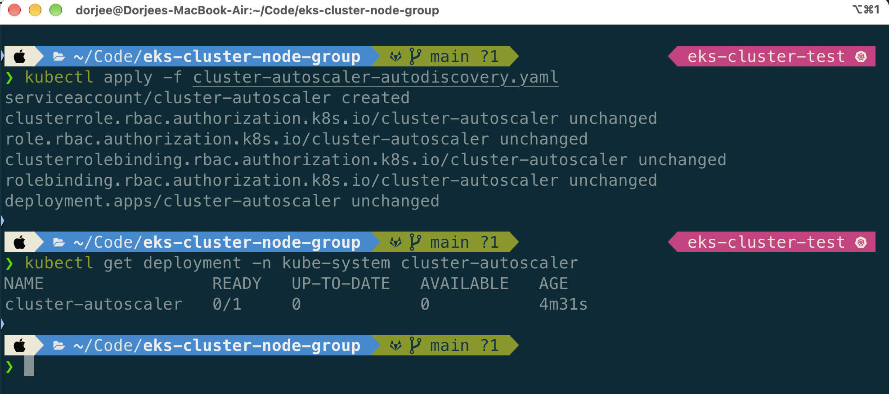

**Case 2: the autoscaler could never scale.** The node group ran min=max=2, so even a correct autoscaler had no room to act. Found while planning the scale-up test; fixed by temporarily raising max to 4, verifying scale up and down, then resetting. Lesson: "the autoscaler fails to act" and "the autoscaler is broken" look identical from the outside — check the ASG limits first.


---

## Roadmap

Deliberate phases rather than a wishlist — this build is phase 1 by design.

- [ ] Phase 2 — Terraform rebuild of the full stack (VPC already has a template; cluster, node group, IAM roles and autoscaler to follow)
- [ ] Phase 3 — GitLab CI: validate and apply the manifests from main
- [ ] Monitoring that's actually used: Grafana dashboards, alert on autoscaler scaling events
- [ ] Tighten IAM: subject-conditioned trust policy, narrowed policy resources, CIDR-restricted API endpoint
- [ ] Private-subnet worker nodes (or delete the unused NAT gateways)

---


## Author

**N.Dorjee**
*CloudBuildOps — DevOps portfolio project*

[](https://github.com/dor-jee)
[](https://gitlab.com/cloudbuildops/)
[](https://dorjee.dev)